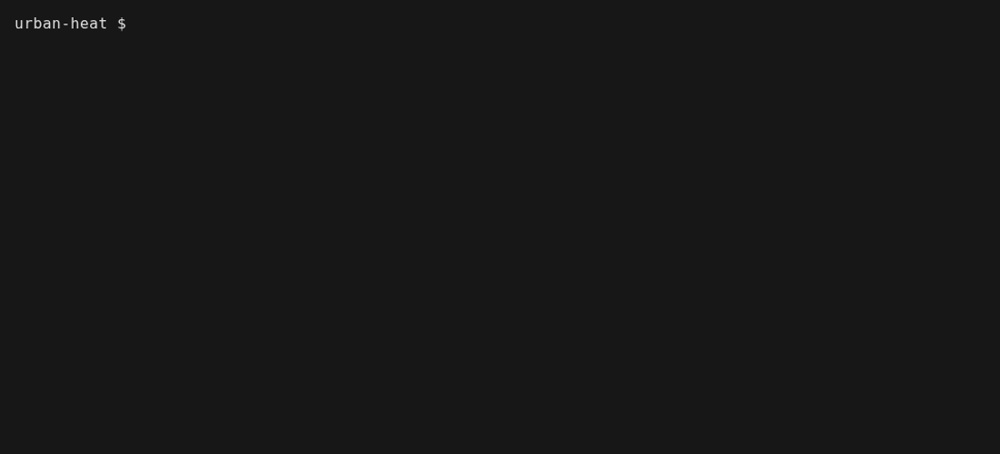

# fair-witness

fair-witness watches a research project folder and has an AI model check each change against the project's data management plan (DMP) in [DAMAP](https://github.com/tuwien-csd/damap-backend). It is for researchers who keep their DMP in DAMAP and want to know as soon as their files stop matching it, such as when a survey export with names lands in a project whose DMP says it holds no personal data.



## Install

macOS and Linux:

```sh
curl --proto '=https' --tlsv1.2 -LsSf https://github.com/vlad-dancea/fair-witness/releases/latest/download/fair-witness-installer.sh | sh
```

Windows (PowerShell):

```powershell
powershell -ExecutionPolicy Bypass -c "irm https://github.com/vlad-dancea/fair-witness/releases/latest/download/fair-witness-installer.ps1 | iex"
```

Check that it works with `fair-witness --version`.

## Quick start

You need a login for a DAMAP with a DMP for your project, by default TU Wien's at [damap.it.tuwien.ac.at](https://damap.it.tuwien.ac.at), and an AI model behind an OpenAI-compatible API, by default TU Wien's [Aqueduct](https://aqueduct.ai.datalab.tuwien.ac.at) with an API token from its web interface. [What you need](docs/usage.md#what-you-need) lists the alternatives.

1. In the folder you want to watch, run `fair-witness setup`. It logs you in to DAMAP and asks which DMP describes the folder and which model to use.
2. Run `fair-witness run` and leave it open while you work.
3. Change files in the folder as you usually do. A few seconds later the changes show up, followed by the model's verdict. A contradiction names the DMP field it clashes with and also shows a desktop notification.

## Documentation

- [Usage](docs/usage.md): setting up a folder, reading the screen, the keys and the commands
- [Configuration](docs/configuration.md): setup without prompts, API keys, the files in `.fair-witness/`, what is ignored and a local DAMAP
- [Running from a script](docs/scripting.md): `fair-witness run --headless`, its events and its exit codes
- [Troubleshooting](docs/troubleshooting.md): what the error messages mean and what to do
- [Development](docs/development.md): building, checking and releasing fair-witness
